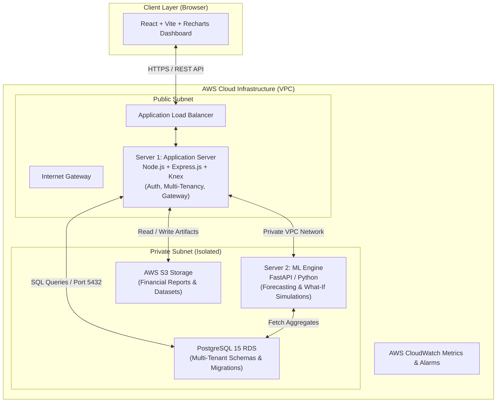

# AI-Powered Retail Financial Planning & Budget Optimization Platform

[](https://nodejs.org/)
[](https://www.postgresql.org/)
[](https://www.docker.com/)
[](https://aws.amazon.com/)
[](https://react.dev/)
[](https://knexjs.org/)

An enterprise-grade, cloud-native financial planning and budget optimization platform designed for multi-store retail organizations. Features AI revenue forecasting, automated CAPEX/OPEX allocation, what-if scenario simulations, and automated AWS CloudFormation deployment templates.

---

## 🏛️ System Architecture

The platform uses a decoupled two-server architecture deployed within an AWS VPC to ensure security, high performance, and clear separation between transactional data processing and intensive analytical compute:



---

## ✨ Key Capabilities

1. **AI-Driven Revenue Forecasting:** Forecasts store-level and category-level monthly revenues using historical transactions across 34 retail locations.
2. **Dynamic Budget & CAPEX/OPEX Optimization:** Algorithmic budget allocations based on store profitability metrics and efficiency ratios.
3. **What-If Scenario Modeling:** Simulates inflation spikes, footfall drop, wage hikes, and tariff adjustments with immediate financial impact assessments.
4. **Multi-Tenant Knex Migrations:** Enterprise database migrations with performance indexes, foreign key constraints, and transactional consistency.
5. **Infrastructure-as-Code (IaC):** Ready-to-deploy AWS CloudFormation template (`aws-cloudformation.json`), PowerShell deployment scripts (`deploy-aws.ps1`), and Lambda serverless triggers (`aws/lambda/`).
6. **Containerized Orchestration:** Multi-container `docker-compose.yml` defining PostgreSQL and Application Server services with automated health checks.

---

## 📂 Project Structure

```
AI-Retail-Financial-planning/
├── .github/
│   └── workflows/
│       └── ci.yml                     # Automated GitHub Actions test & build pipeline
├── application-server/                # Server 1: Core Node.js / Express backend
│   ├── database/
│   │   └── migrations/                # Knex schema migrations & indexing
│   ├── scripts/                       # Dataset import, seed, and export utilities
│   ├── src/
│   │   ├── config/                    # Database (Knex) & environment configs
│   │   ├── controllers/               # Auth, stores, financial plans, scenarios
│   │   ├── middleware/                # JWT authentication & role-based access
│   │   └── routes/                    # REST API routing definitions
│   ├── tests/                         # Supertest automated integration test suite
│   ├── Dockerfile                     # Multi-stage container definition
│   └── knexfile.js                    # Knex database connection profiles
├── aws/                               # AWS Cloud resources
│   ├── cloudformation/                # Modular CloudFormation stacks
│   ├── lambda/                        # Serverless financial calculation triggers
│   └── scripts/                       # Automated deployment automation
├── docs/                              # Deep engineering specifications
│   ├── ARCHITECTURE.md                # System topology & network security
│   ├── API_DOCUMENTATION.md           # Complete endpoint specifications
│   ├── DATABASE_SCHEMA.md             # ER diagrams and column dictionaries
│   ├── DATASET_ANALYSIS.md            # Statistical distribution of sales data
│   ├── DATA_PIPELINE.md               # ETL and batch aggregation pipelines
│   └── DEPLOYMENT.md                  # AWS and local deployment walkthroughs
├── frontend/                          # Client Layer: React, Vite & Tailwind CSS
├── aws-cloudformation.json            # Master AWS CloudFormation IaC template
├── deploy-aws.ps1                     # AWS deployment automation script
├── docker-compose.yml                 # Multi-service local environment
└── README.md                          # Repository overview
```

---

## 🚀 Quick Start & Local Execution

### Option A: Running via Docker Compose (Recommended)

Start the PostgreSQL database and Application Server with a single command:

```bash
docker-compose up -d --build
```

Access the application server at `http://localhost:5000` and healthcheck at `http://localhost:5000/health`.

---

### Option B: Running Locally

#### 1. Setup Application Server
```bash
cd application-server

# Install dependencies
npm install

# Copy environment template
cp .env.example .env

# Run database migrations
npm run migrate

# Seed sample retail dataset
npm run seed

# Run automated Supertest test suite
npm test

# Start the application server
npm run dev
```

#### 2. Setup Frontend
```bash
cd ../frontend

# Install dependencies
npm install

# Launch Vite development server
npm run dev
```

---

## 🧪 Automated Testing

The backend includes a comprehensive integration test suite (`application-server/tests/run-tests.js`) verifying:
- `/health` service availability
- User registration, password hashing (bcrypt), and JWT token generation
- Role-based authorization (`ADMIN` vs `STAFF`)
- Store registration and financial budget record creation
- Migration schema validation

Run the test suite:
```bash
cd application-server
npm test
```

---

## 📚 Detailed Documentation Index

For in-depth specifications, refer to the documentation in [`docs/`](docs/):
- **[System Architecture](docs/ARCHITECTURE.md):** Security, VPC subnets, and AWS topology.
- **[API Documentation](docs/API_DOCUMENTATION.md):** REST endpoints, headers, and payload schemas.
- **[Database Schema](docs/DATABASE_SCHEMA.md):** Relational models, data dictionary, and indexes.
- **[Dataset Analysis](docs/DATASET_ANALYSIS.md):** 34 stores and 3,600 historical sales transactions.
- **[Deployment Guide](docs/DEPLOYMENT.md):** Production rollout on AWS EC2, RDS, and S3.

---

## 📄 License
This project is licensed under the MIT License.
