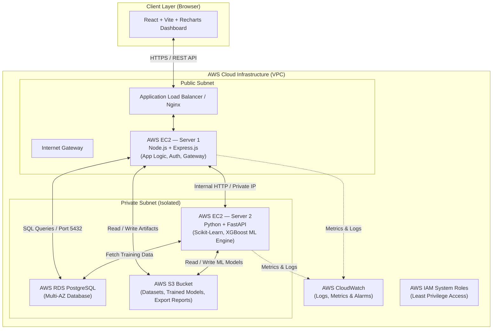

# System & AWS Cloud Architecture Specification

## 1. High-Level Architecture Overview

The **AI-Powered Retail Financial Planning Platform** utilizes an enterprise-grade, decoupled **Two-Server Architecture** deployed on Amazon Web Services (AWS). 

The platform guarantees strict separation of concerns:
1. **Server 1 (Application Server)** handles core business logic, user authentication, multi-tenancy, transactional data persistence, and UI request orchestration.
2. **Server 2 (AI/ML Server)** acts as a specialized compute node dedicated to statistical forecasting, machine learning inference, what-if scenario simulations, and budget optimization algorithms.

The React frontend never communicates directly with Server 2. Server 1 serves as an API Gateway and security boundary for all machine learning operations.

---

## 2. Component Interaction & Flow Diagram

---

## 3. Server Specifications & Responsibilities

### Server 1: Application Server
- **Tech Stack**: Node.js, Express.js, PostgreSQL Driver (`pg` / `sequelize` / `prisma`), JWT, bcrypt, Axios, dotenv, CORS.
- **Hosting Environment**: AWS EC2 Instance (Ubuntu 22.04 LTS) running Nginx reverse proxy and PM2 process manager.
- **Key Responsibilities**:
  - **Authentication & RBAC**: User registration, login, JWT issuance, password hashing, and role validation (`ADMIN`, `MANAGER`, `ANALYST`, `STAFF`).
  - **Multi-Tenancy**: Organization isolation and tenancy contextualization.
  - **Core Business Entities**: CRUD for Organizations, Stores, Business Units, Products, Categories, Sales, Expenses, Budgets, and Financial Plans.
  - **Financial Engine**: Variance computation (Planned vs Actual), budget allocation monitoring, and report generation.
  - **ML Orchestration Gateway**: Sanitizes requests, routes inference calls to Server 2 via private internal IP, and formats responses for the frontend.

### Server 2: AI/ML Server
- **Tech Stack**: Python 3.10+, FastAPI, Uvicorn, Pandas, NumPy, Scikit-learn, XGBoost, Joblib.
- **Hosting Environment**: AWS EC2 Instance (Ubuntu 22.04 LTS with CPU/GPU optimization) running Nginx reverse proxy and Gunicorn/Uvicorn workers.
- **Key Responsibilities**:
  - `POST /api/ml/forecast/sales`: Time-series sales forecasting by Store, Product, Category, and Business Unit using XGBoost / Random Forest.
  - `POST /api/ml/forecast/expenses`: Machine learning expense projection based on operational trends.
  - `POST /api/ml/forecast/profit`: Integrated revenue, expense, net profit, and profit-margin predictive modeling.
  - `POST /api/ml/predict/risk`: Financial Risk Score computation (0-100) and risk level assignment (`LOW`, `MEDIUM`, `HIGH`, `CRITICAL`).
  - `POST /api/ml/optimize/budget`: Constrained budget reallocation optimization using machine learning heuristics.
  - `POST /api/ml/simulate/what-if`: Multi-variable financial scenario simulation engine.

---

## 4. AWS Infrastructure & Security Architecture

### A. Virtual Private Cloud (VPC) Setup
- **VPC Network**: `10.0.0.0/16` CIDR block.
- **Public Subnet**: `10.0.1.0/24` (Hosts Server 1 EC2 instance & Application Load Balancer).
- **Private Subnet 1**: `10.0.2.0/24` (Hosts Server 2 ML EC2 instance — inaccessible from public internet).
- **Private Subnet 2**: `10.0.3.0/24` (Hosts RDS PostgreSQL DB instance).

### B. Security Groups & Network ACLs
- **Server 1 SG**: Inbound TCP 80/443 from Load Balancer; Outbound TCP 5432 to RDS SG, Outbound TCP 8000 to Server 2 SG.
- **Server 2 SG**: Inbound TCP 8000 *only* from Server 1 SG IP; no direct internet ingress.
- **RDS SG**: Inbound TCP 5432 *only* from Server 1 SG and Server 2 SG.

### C. Storage & Management Services
- **AWS S3 Bucket**: Stores raw Kaggle CSV, ETL processed datasets, serialized trained ML model artifacts (`.joblib` / `.pkl`), and exported financial PDF/CSV reports.
- **AWS IAM Roles**: EC2 Instance Profiles with strict least-privilege S3 access policies (`s3:GetObject`, `s3:PutObject`). Zero hardcoded credentials in codebase.
- **AWS CloudWatch**: Standard monitoring agent for CPU utilization, RAM usage, application log aggregation (`/var/log/nginx/`, Node.js stdout, FastAPI logs), and metric alarms.
