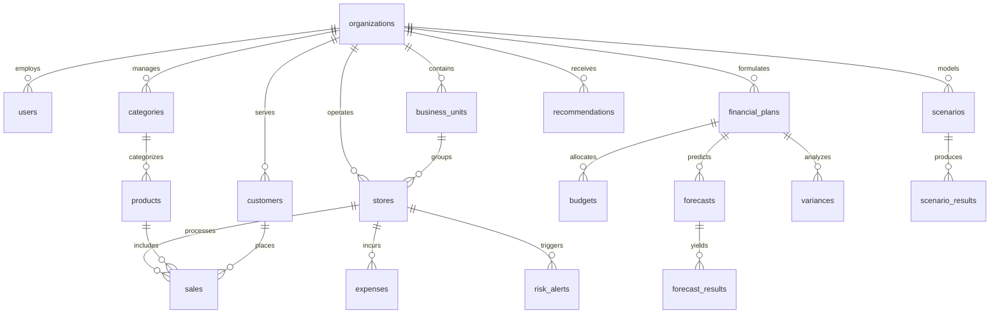

# PostgreSQL Database Schema Specification

## 1. Overview & Multi-Tenancy Architecture

The database is built on **PostgreSQL** to support high-throughput analytical queries, strict transactional integrity, and multi-tenant isolation.

- **Multi-Tenancy**: Every organization-scoped table includes an `organization_id` foreign key with indexing to enforce strict data partitioning.
- **Primary Keys**: UUID v4 for unique entity identification across distributed environments.
- **Monetary Precision**: All monetary values use `NUMERIC(15, 2)` to prevent floating-point rounding errors.
- **Timestamps**: `TIMESTAMP WITH TIME ZONE` (`TIMESTAMPTZ`) for timezone-aware temporal tracking.

---

## 2. Entity Relationship Diagram (ERD)



---

## 3. Comprehensive Table Definitions

### 1. `organizations`
Stores tenant company profiles.
```sql
CREATE TABLE organizations (
    id UUID PRIMARY KEY DEFAULT gen_random_uuid(),
    name VARCHAR(255) NOT NULL,
    code VARCHAR(50) UNIQUE NOT NULL,
    currency VARCHAR(10) DEFAULT 'INR',
    created_at TIMESTAMPTZ DEFAULT CURRENT_TIMESTAMP,
    updated_at TIMESTAMPTZ DEFAULT CURRENT_TIMESTAMP
);
```

### 2. `users`
System users with Role-Based Access Control (RBAC: ADMIN, MANAGER, ANALYST, STAFF).
```sql
CREATE TABLE users (
    id UUID PRIMARY KEY DEFAULT gen_random_uuid(),
    organization_id UUID NOT NULL REFERENCES organizations(id) ON DELETE CASCADE,
    email VARCHAR(255) UNIQUE NOT NULL,
    password_hash VARCHAR(255) NOT NULL,
    first_name VARCHAR(100) NOT NULL,
    last_name VARCHAR(100) NOT NULL,
    role VARCHAR(50) NOT NULL CHECK (role IN ('ADMIN', 'MANAGER', 'ANALYST', 'STAFF')),
    is_active BOOLEAN DEFAULT TRUE,
    created_at TIMESTAMPTZ DEFAULT CURRENT_TIMESTAMP,
    updated_at TIMESTAMPTZ DEFAULT CURRENT_TIMESTAMP
);
CREATE INDEX idx_users_org ON users(organization_id);
```

### 3. `business_units`
Organizational divisions grouping regional or store operations.
```sql
CREATE TABLE business_units (
    id UUID PRIMARY KEY DEFAULT gen_random_uuid(),
    organization_id UUID NOT NULL REFERENCES organizations(id) ON DELETE CASCADE,
    name VARCHAR(255) NOT NULL,
    region VARCHAR(100) NOT NULL,
    description TEXT,
    created_at TIMESTAMPTZ DEFAULT CURRENT_TIMESTAMP,
    updated_at TIMESTAMPTZ DEFAULT CURRENT_TIMESTAMP
);
CREATE INDEX idx_bu_org ON business_units(organization_id);
```

### 4. `stores`
Physical retail stores mapped from dataset location hierarchy.
```sql
CREATE TABLE stores (
    id UUID PRIMARY KEY DEFAULT gen_random_uuid(),
    organization_id UUID NOT NULL REFERENCES organizations(id) ON DELETE CASCADE,
    business_unit_id UUID REFERENCES business_units(id) ON DELETE SET NULL,
    store_code VARCHAR(50) NOT NULL,
    state VARCHAR(100) NOT NULL,
    postal_code VARCHAR(20) NOT NULL,
    city_type VARCHAR(50) NOT NULL CHECK (city_type IN ('Tier 1', 'Tier 2', 'Village')),
    outlet_type VARCHAR(50) NOT NULL CHECK (outlet_type IN ('Large', 'Medium', 'Small')),
    region VARCHAR(50) NOT NULL,
    country VARCHAR(50) DEFAULT 'India',
    created_at TIMESTAMPTZ DEFAULT CURRENT_TIMESTAMP,
    updated_at TIMESTAMPTZ DEFAULT CURRENT_TIMESTAMP,
    CONSTRAINT uq_org_store_code UNIQUE (organization_id, store_code)
);
CREATE INDEX idx_stores_org ON stores(organization_id);
CREATE INDEX idx_stores_bu ON stores(business_unit_id);
```

### 5. `categories`
Product category and sub-category hierarchy.
```sql
CREATE TABLE categories (
    id UUID PRIMARY KEY DEFAULT gen_random_uuid(),
    organization_id UUID NOT NULL REFERENCES organizations(id) ON DELETE CASCADE,
    category_name VARCHAR(150) NOT NULL,
    sub_category_name VARCHAR(150) NOT NULL,
    created_at TIMESTAMPTZ DEFAULT CURRENT_TIMESTAMP,
    updated_at TIMESTAMPTZ DEFAULT CURRENT_TIMESTAMP,
    CONSTRAINT uq_cat_subcat UNIQUE (organization_id, category_name, sub_category_name)
);
CREATE INDEX idx_categories_org ON categories(organization_id);
```

### 6. `products`
Retail merchandise items.
```sql
CREATE TABLE products (
    id UUID PRIMARY KEY DEFAULT gen_random_uuid(),
    organization_id UUID NOT NULL REFERENCES organizations(id) ON DELETE CASCADE,
    category_id UUID NOT NULL REFERENCES categories(id) ON DELETE RESTRICT,
    product_code VARCHAR(100) NOT NULL,
    product_name VARCHAR(255) NOT NULL,
    created_at TIMESTAMPTZ DEFAULT CURRENT_TIMESTAMP,
    updated_at TIMESTAMPTZ DEFAULT CURRENT_TIMESTAMP,
    CONSTRAINT uq_org_product_code UNIQUE (organization_id, product_code)
);
CREATE INDEX idx_products_org ON products(organization_id);
CREATE INDEX idx_products_cat ON products(category_id);
```

### 7. `customers`
Customer demographic profiles.
```sql
CREATE TABLE customers (
    id UUID PRIMARY KEY DEFAULT gen_random_uuid(),
    organization_id UUID NOT NULL REFERENCES organizations(id) ON DELETE CASCADE,
    customer_code VARCHAR(100) NOT NULL,
    first_name VARCHAR(100),
    last_name VARCHAR(100),
    date_of_birth DATE,
    segment VARCHAR(50) CHECK (segment IN ('Consumer', 'Corporate')),
    created_at TIMESTAMPTZ DEFAULT CURRENT_TIMESTAMP,
    updated_at TIMESTAMPTZ DEFAULT CURRENT_TIMESTAMP,
    CONSTRAINT uq_org_cust_code UNIQUE (organization_id, customer_code)
);
CREATE INDEX idx_customers_org ON customers(organization_id);
```

### 8. `sales`
Transaction sales records loaded directly from Kaggle dataset.
```sql
CREATE TABLE sales (
    id UUID PRIMARY KEY DEFAULT gen_random_uuid(),
    organization_id UUID NOT NULL REFERENCES organizations(id) ON DELETE CASCADE,
    store_id UUID NOT NULL REFERENCES stores(id) ON DELETE RESTRICT,
    product_id UUID NOT NULL REFERENCES products(id) ON DELETE RESTRICT,
    customer_id UUID REFERENCES customers(id) ON DELETE SET NULL,
    order_id VARCHAR(100) NOT NULL,
    sales_date DATE NOT NULL,
    order_date DATE NOT NULL,
    ship_date DATE,
    ship_mode VARCHAR(50),
    year INT NOT NULL,
    quantity INT NOT NULL CHECK (quantity > 0),
    sales_amount NUMERIC(15, 2) NOT NULL CHECK (sales_amount >= 0),
    discount NUMERIC(5, 4) DEFAULT 0.0 CHECK (discount >= 0 AND discount <= 1.0),
    profit_amount NUMERIC(15, 2) NOT NULL,
    created_at TIMESTAMPTZ DEFAULT CURRENT_TIMESTAMP
);
CREATE INDEX idx_sales_org_date ON sales(organization_id, sales_date);
CREATE INDEX idx_sales_store ON sales(store_id);
CREATE INDEX idx_sales_product ON sales(product_id);
```

### 9. `expenses`
Operating expenses recorded per store/category per period.
```sql
CREATE TABLE expenses (
    id UUID PRIMARY KEY DEFAULT gen_random_uuid(),
    organization_id UUID NOT NULL REFERENCES organizations(id) ON DELETE CASCADE,
    store_id UUID REFERENCES stores(id) ON DELETE CASCADE,
    expense_category VARCHAR(100) NOT NULL CHECK (expense_category IN (
        'Marketing', 'Operations', 'Rent', 'Employee', 'Utilities', 'Logistics', 'Inventory', 'Other'
    )),
    amount NUMERIC(15, 2) NOT NULL CHECK (amount >= 0),
    expense_date DATE NOT NULL,
    period_type VARCHAR(20) DEFAULT 'MONTHLY' CHECK (period_type IN ('MONTHLY', 'QUARTERLY', 'ANNUAL')),
    description TEXT,
    created_at TIMESTAMPTZ DEFAULT CURRENT_TIMESTAMP
);
CREATE INDEX idx_expenses_org_date ON expenses(organization_id, expense_date);
CREATE INDEX idx_expenses_store ON expenses(store_id);
```

### 10. `financial_plans`
Top-level targets (Monthly, Quarterly, Annual).
```sql
CREATE TABLE financial_plans (
    id UUID PRIMARY KEY DEFAULT gen_random_uuid(),
    organization_id UUID NOT NULL REFERENCES organizations(id) ON DELETE CASCADE,
    business_unit_id UUID REFERENCES business_units(id) ON DELETE SET NULL,
    store_id UUID REFERENCES stores(id) ON DELETE SET NULL,
    plan_name VARCHAR(255) NOT NULL,
    period_type VARCHAR(20) NOT NULL CHECK (period_type IN ('MONTHLY', 'QUARTERLY', 'ANNUAL')),
    year INT NOT NULL,
    period_number INT NOT NULL, -- 1-12 for monthly, 1-4 for quarterly
    target_revenue NUMERIC(15, 2) NOT NULL,
    target_expense NUMERIC(15, 2) NOT NULL,
    target_profit NUMERIC(15, 2) NOT NULL,
    target_profit_margin NUMERIC(5, 2) NOT NULL,
    created_at TIMESTAMPTZ DEFAULT CURRENT_TIMESTAMP,
    updated_at TIMESTAMPTZ DEFAULT CURRENT_TIMESTAMP
);
CREATE INDEX idx_plans_org ON financial_plans(organization_id);
```

### 11. `budgets`
Detailed budget allocations linked to financial plans.
```sql
CREATE TABLE budgets (
    id UUID PRIMARY KEY DEFAULT gen_random_uuid(),
    organization_id UUID NOT NULL REFERENCES organizations(id) ON DELETE CASCADE,
    financial_plan_id UUID NOT NULL REFERENCES financial_plans(id) ON DELETE CASCADE,
    expense_category VARCHAR(100) NOT NULL,
    allocated_amount NUMERIC(15, 2) NOT NULL CHECK (allocated_amount >= 0),
    actual_amount NUMERIC(15, 2) DEFAULT 0.00,
    status VARCHAR(50) DEFAULT 'ON TRACK' CHECK (status IN ('ON TRACK', 'WARNING', 'OVER BUDGET')),
    created_at TIMESTAMPTZ DEFAULT CURRENT_TIMESTAMP,
    updated_at TIMESTAMPTZ DEFAULT CURRENT_TIMESTAMP
);
CREATE INDEX idx_budgets_org ON budgets(organization_id);
CREATE INDEX idx_budgets_plan ON budgets(financial_plan_id);
```

### 12. `forecasts`
ML forecasting metadata runs.
```sql
CREATE TABLE forecasts (
    id UUID PRIMARY KEY DEFAULT gen_random_uuid(),
    organization_id UUID NOT NULL REFERENCES organizations(id) ON DELETE CASCADE,
    forecast_type VARCHAR(50) NOT NULL CHECK (forecast_type IN ('SALES', 'EXPENSE', 'PROFIT')),
    granularity VARCHAR(50) NOT NULL CHECK (granularity IN ('STORE', 'PRODUCT', 'CATEGORY', 'BUSINESS_UNIT', 'ORGANIZATION')),
    target_entity_id UUID,
    model_used VARCHAR(100) NOT NULL, -- e.g., 'XGBoost', 'Random Forest', 'Linear Regression'
    horizon_months INT NOT NULL,
    mae NUMERIC(10, 4),
    rmse NUMERIC(10, 4),
    mape NUMERIC(10, 4),
    created_at TIMESTAMPTZ DEFAULT CURRENT_TIMESTAMP
);
CREATE INDEX idx_forecasts_org ON forecasts(organization_id);
```

### 13. `forecast_results`
Individual forecast time-series output records.
```sql
CREATE TABLE forecast_results (
    id UUID PRIMARY KEY DEFAULT gen_random_uuid(),
    forecast_id UUID NOT NULL REFERENCES forecasts(id) ON DELETE CASCADE,
    forecast_date DATE NOT NULL,
    predicted_value NUMERIC(15, 2) NOT NULL,
    lower_bound NUMERIC(15, 2),
    upper_bound NUMERIC(15, 2),
    actual_value NUMERIC(15, 2), -- Populated retroactively for accuracy tracking
    created_at TIMESTAMPTZ DEFAULT CURRENT_TIMESTAMP
);
CREATE INDEX idx_forecast_results_id ON forecast_results(forecast_id, forecast_date);
```

### 14. `variances`
Planned vs Actual financial variance analysis metrics.
```sql
CREATE TABLE variances (
    id UUID PRIMARY KEY DEFAULT gen_random_uuid(),
    organization_id UUID NOT NULL REFERENCES organizations(id) ON DELETE CASCADE,
    financial_plan_id UUID REFERENCES financial_plans(id) ON DELETE CASCADE,
    store_id UUID REFERENCES stores(id) ON DELETE CASCADE,
    category_id UUID REFERENCES categories(id) ON DELETE CASCADE,
    period_date DATE NOT NULL,
    planned_revenue NUMERIC(15, 2) NOT NULL,
    actual_revenue NUMERIC(15, 2) NOT NULL,
    revenue_variance NUMERIC(15, 2) NOT NULL,
    planned_expense NUMERIC(15, 2) NOT NULL,
    actual_expense NUMERIC(15, 2) NOT NULL,
    expense_variance NUMERIC(15, 2) NOT NULL,
    planned_profit NUMERIC(15, 2) NOT NULL,
    actual_profit NUMERIC(15, 2) NOT NULL,
    profit_variance NUMERIC(15, 2) NOT NULL,
    is_favorable BOOLEAN NOT NULL,
    created_at TIMESTAMPTZ DEFAULT CURRENT_TIMESTAMP
);
CREATE INDEX idx_variances_org_date ON variances(organization_id, period_date);
```

### 15. `scenarios`
What-If scenario simulation configurations.
```sql
CREATE TABLE scenarios (
    id UUID PRIMARY KEY DEFAULT gen_random_uuid(),
    organization_id UUID NOT NULL REFERENCES organizations(id) ON DELETE CASCADE,
    created_by UUID REFERENCES users(id) ON DELETE SET NULL,
    scenario_name VARCHAR(255) NOT NULL,
    sales_growth_change NUMERIC(5, 2) DEFAULT 0.0, -- Percentage change
    price_change NUMERIC(5, 2) DEFAULT 0.0,
    discount_change NUMERIC(5, 2) DEFAULT 0.0,
    marketing_budget_change NUMERIC(5, 2) DEFAULT 0.0,
    opex_change NUMERIC(5, 2) DEFAULT 0.0,
    supplier_cost_change NUMERIC(5, 2) DEFAULT 0.0,
    created_at TIMESTAMPTZ DEFAULT CURRENT_TIMESTAMP
);
CREATE INDEX idx_scenarios_org ON scenarios(organization_id);
```

### 16. `scenario_results`
Calculated outcome metrics for What-If scenario simulations.
```sql
CREATE TABLE scenario_results (
    id UUID PRIMARY KEY DEFAULT gen_random_uuid(),
    scenario_id UUID NOT NULL REFERENCES scenarios(id) ON DELETE CASCADE,
    baseline_revenue NUMERIC(15, 2) NOT NULL,
    simulated_revenue NUMERIC(15, 2) NOT NULL,
    baseline_expense NUMERIC(15, 2) NOT NULL,
    simulated_expense NUMERIC(15, 2) NOT NULL,
    baseline_profit NUMERIC(15, 2) NOT NULL,
    simulated_profit NUMERIC(15, 2) NOT NULL,
    baseline_margin NUMERIC(5, 2) NOT NULL,
    simulated_margin NUMERIC(5, 2) NOT NULL,
    created_at TIMESTAMPTZ DEFAULT CURRENT_TIMESTAMP
);
```

### 17. `risk_alerts`
Early Warning System notification logs.
```sql
CREATE TABLE risk_alerts (
    id UUID PRIMARY KEY DEFAULT gen_random_uuid(),
    organization_id UUID NOT NULL REFERENCES organizations(id) ON DELETE CASCADE,
    store_id UUID REFERENCES stores(id) ON DELETE CASCADE,
    alert_type VARCHAR(100) NOT NULL CHECK (alert_type IN ('BUDGET_OVERRUN', 'PROFITABILITY_RISK', 'REVENUE_RISK', 'EXPENSE_RISK')),
    severity VARCHAR(20) NOT NULL CHECK (severity IN ('LOW', 'MEDIUM', 'HIGH', 'CRITICAL')),
    risk_score NUMERIC(5, 2) NOT NULL,
    description TEXT NOT NULL,
    recommended_action TEXT,
    status VARCHAR(20) DEFAULT 'ACTIVE' CHECK (status IN ('ACTIVE', 'ACKNOWLEDGED', 'RESOLVED')),
    created_at TIMESTAMPTZ DEFAULT CURRENT_TIMESTAMP,
    updated_at TIMESTAMPTZ DEFAULT CURRENT_TIMESTAMP
);
CREATE INDEX idx_alerts_org_status ON risk_alerts(organization_id, status);
```

### 18. `recommendations`
AI-generated budget optimization and operational recommendations.
```sql
CREATE TABLE recommendations (
    id UUID PRIMARY KEY DEFAULT gen_random_uuid(),
    organization_id UUID NOT NULL REFERENCES organizations(id) ON DELETE CASCADE,
    store_id UUID REFERENCES stores(id) ON DELETE CASCADE,
    category_id UUID REFERENCES categories(id) ON DELETE CASCADE,
    recommendation_type VARCHAR(100) NOT NULL,
    title VARCHAR(255) NOT NULL,
    reason TEXT NOT NULL,
    expected_impact TEXT NOT NULL,
    priority VARCHAR(20) CHECK (priority IN ('LOW', 'MEDIUM', 'HIGH')),
    confidence_score NUMERIC(5, 2) NOT NULL,
    is_applied BOOLEAN DEFAULT FALSE,
    created_at TIMESTAMPTZ DEFAULT CURRENT_TIMESTAMP
);
CREATE INDEX idx_recs_org ON recommendations(organization_id);
```
