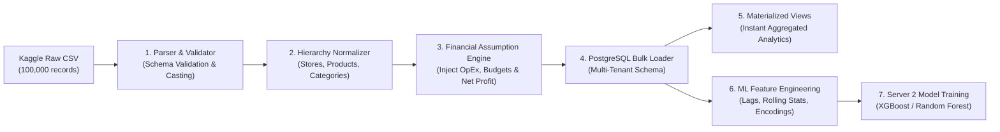

# Data Pipeline & ETL Architecture Specification

## 1. Overview & Data Flow Diagram

The **Data Pipeline** transforms raw Kaggle store sales transaction records into an enriched, multi-tenant relational schema equipped with financial assumptions, automated aggregations, and ML feature representations.



---

## 2. Ingestion & Preprocessing Steps

### Step 1: Parsing & Validation
- **Source**: `kaggle dataset/store_sales_data (2).csv`
- **Validation Rules**:
  - Verify 25 mandatory columns are present.
  - Coerce numeric columns (`Sales`, `Profit`, `Discount`, `Quantity`, `Postal Code`) to exact numeric types.
  - Format date strings (`Sales Date`, `Order Date`, `Ship Date`, `Date of Birth`) to `YYYY-MM-DD`.
  - Validate zero nulls and zero duplicate rows across the dataset.

### Step 2: Entity Mapping & Normalization
The dataset is normalized into distinct relational entities:
- **Organization Entity**: Default tenant (`ORG-DEFAULT-001` - "RetailCorp India").
- **Store Entity Mapping**: Derived from `(State, Postal Code, Outlet Type, City Type)`. Each distinct combination forms a unique `Store` record with auto-generated code (e.g., `STORE-WB-700001-L`).
- **Category Entity Mapping**: Unique combinations of `Category of Goods` and `Sub-Category`.
- **Product Entity Mapping**: Map `Product ID` and `Product Name` under corresponding Category ID.
- **Customer Entity Mapping**: Map `Customer ID`, `Customer Name`, `Last Name`, `Date of Birth`, and `Segment`.

---

## 3. Financial Assumption Layer Integration

During ETL processing, the **Financial Assumption Engine** (`docs/FINANCIAL_ASSUMPTIONS.md`) runs to generate operating expenses and baseline financial planning targets:

1. **Operating Expense Generation**:
   - Compute Fixed Rent per store-month based on `Outlet Type` and `City Type`.
   - Compute Variable OpEx per transaction: Marketing (6.5%), Staffing (9.0%), Utilities (2.5%), Logistics (3.5%), Admin (1.5%).
   - Calculate transaction-level Net Profit: `Gross Profit - Variable OpEx`.

2. **Historical Budget & Plan Baseline Generation**:
   - Aggregate sales and expenses by Store, Business Unit, and Category for years 2019–2023 by Month and Quarter.
   - Synthesize `Financial Plan` targets with a baseline target growth factor $g = 0.08$ (+8% over prior period).
   - Generate `Budget` allocations across 7 core expense categories.
   - Compute historical `Variance` metrics (Favorable vs Unfavorable) and `Risk Alert` logs.

---

## 4. Materialized Views for High-Performance Analytics

To power the dashboard charts without calculating live aggregations over 100,000 transaction rows on every HTTP request, PostgreSQL **Materialized Views** are instantiated and periodically refreshed:

### 1. `mv_monthly_store_financials`
```sql
CREATE MATERIALIZED VIEW mv_monthly_store_financials AS
SELECT 
    s.organization_id,
    s.store_id,
    st.store_code,
    st.state,
    st.region,
    st.outlet_type,
    DATE_TRUNC('month', s.sales_date)::DATE AS sales_month,
    SUM(s.sales_amount) AS total_revenue,
    SUM(s.sales_amount - s.profit_amount) AS total_cogs,
    SUM(s.profit_amount) AS gross_profit,
    SUM(s.sales_amount * 0.23) + MAX(rent_table.monthly_rent) AS total_opex,
    SUM(s.profit_amount) - (SUM(s.sales_amount * 0.23) + MAX(rent_table.monthly_rent)) AS net_profit,
    ROUND((SUM(s.profit_amount) / NULLIF(SUM(s.sales_amount), 0)) * 100, 2) AS gross_margin_pct
FROM sales s
JOIN stores st ON s.store_id = st.id
LEFT JOIN (
    SELECT 'Large' as outlet_type, 150000 as monthly_rent UNION ALL
    SELECT 'Medium', 90000 UNION ALL
    SELECT 'Small', 45000
) rent_table ON st.outlet_type = rent_table.outlet_type
GROUP BY s.organization_id, s.store_id, st.store_code, st.state, st.region, st.outlet_type, DATE_TRUNC('month', s.sales_date);

CREATE UNIQUE INDEX idx_mv_store_month ON mv_monthly_store_financials(organization_id, store_id, sales_month);
```

### 2. `mv_category_performance`
```sql
CREATE MATERIALIZED VIEW mv_category_performance AS
SELECT 
    s.organization_id,
    c.id AS category_id,
    c.category_name,
    c.sub_category_name,
    DATE_TRUNC('month', s.sales_date)::DATE AS sales_month,
    SUM(s.quantity) AS total_quantity,
    SUM(s.sales_amount) AS total_revenue,
    SUM(s.profit_amount) AS gross_profit,
    AVG(s.discount) AS avg_discount
FROM sales s
JOIN products p ON s.product_id = p.id
JOIN categories c ON p.category_id = c.id
GROUP BY s.organization_id, c.id, c.category_name, c.sub_category_name, DATE_TRUNC('month', s.sales_date);

CREATE UNIQUE INDEX idx_mv_cat_month ON mv_category_performance(organization_id, category_id, sales_month);
```

---

## 5. Machine Learning Feature Engineering Pipeline

For Server 2 ML models, the dataset is transformed into a supervised time-series feature matrix:

1. **Temporal Features**:
   - `month` (1-12), `quarter` (1-4), `year` (2019-2023), `day_of_week` (0-6), `is_weekend`.
2. **Time-Series Lag Features**:
   - `sales_lag_1m`: Sales from previous month.
   - `sales_lag_3m`: Sales from 3 months prior.
   - `sales_lag_12m`: Same month previous year sales (Year-over-Year seasonality).
3. **Rolling Statistics**:
   - `sales_rolling_mean_3m`: 3-month moving average sales.
   - `sales_rolling_std_3m`: 3-month sales volatility.
   - `discount_rolling_avg`: 3-month average discount rate.
4. **Categorical Encodings**:
   - One-hot encoding for `Outlet Type`, `City Type`, `Region`, and `Category of Goods`.
5. **Temporal Train/Test Split**:
   - **Training Set**: Historical data from `2019-01-01` to `2022-12-31` (80,000+ orders / 48 months).
   - **Validation / Test Set**: Data from `2023-01-01` to `2023-12-31` (20,000 orders / 12 months).
